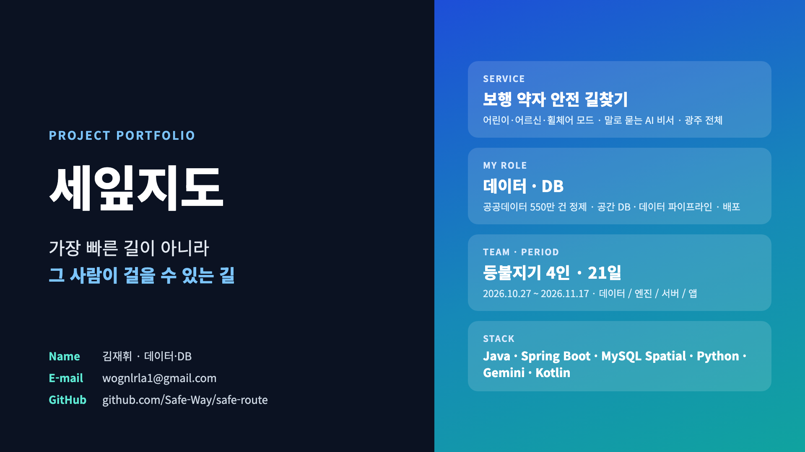
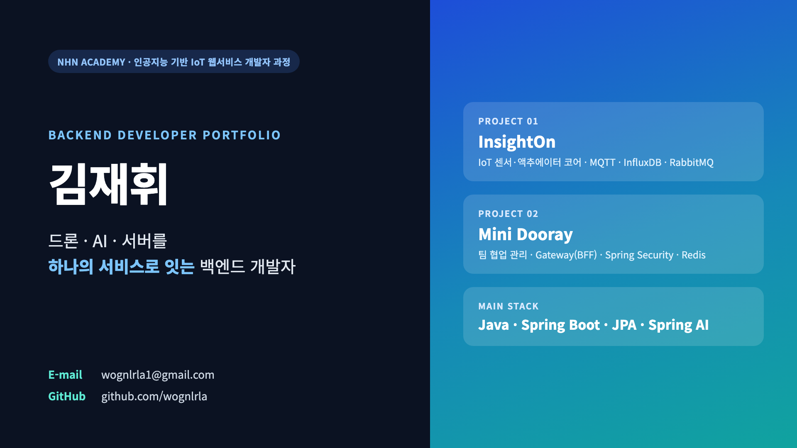

## 안녕하세요, 백엔드 개발자 김재휘입니다

**IoT · AI · 데이터를 하나의 서비스로 잇는 백엔드 개발자**입니다.
Java · Spring Boot로 서버를 만들고, 데이터가 서비스 안에서 끝까지 맞게 흐르도록 설계하는 일을 좋아합니다.

- **함께 만드는 사람**: 팀의 서비스 경계와 API 규격을 먼저 맞추고, 결정은 문서로 남깁니다.
- **새 기술을 두려워하지 않는 사람**: MQTT · DL4J · Spring AI(MCP) · 공간 DB까지, 필요하면 바로 배워 씁니다.
- **마감 안에 완성하는 사람**: 리뷰할 수 있는 단위로 PR을 나눠 정해진 시간 안에 끝냅니다.
- **직접 띄워서 쓰게 만드는 사람**: 서버에서 끝내지 않고 화면과 배포까지 붙여, 다른 사람이 주소 하나로 바로 써 볼 수 있게 만듭니다.

## 포트폴리오

<table>
<tr>
<td width="50%"></td>
<td width="50%"></td>
</tr>
<tr>
<td><b><a href="portfolio/saferoute-portfolio.pdf">세잎지도 프로젝트 포트폴리오</a></b> (PDF, 12쪽) 문제와 목표 · 데이터 구조 · 트러블슈팅 · 현장 검증 · 협업</td>
<td><b><a href="portfolio/backend-portfolio.pdf">백엔드 개발자 포트폴리오</a></b> (PDF, 11쪽) InsightOn · Mini Dooray — 구조 · 트러블슈팅 · 서비스 경계</td>
</tr>
</table>

**[이력서 · 자기소개서 (Word)](resume/이력서_자기소개서_김재휘.docx)**: 기술 스택 · 교육 · 프로젝트(세잎지도 · InsightOn · AI-fly-schedule · Mini Dooray) · 자기소개서

## 프로젝트

### 팀 프로젝트

| 프로젝트 | 기간 · 인원 | 맡은 일 | 결과 |
|---|---|---|---|
| **[세잎지도](https://github.com/Safe-Way/safe-route)** 보행 약자 안전 길찾기 | 2026.10 ~ 11 · 4인 | 데이터 · DB | 공공데이터 약 550만 건 → 안전 시설 10만여 곳을 길에 연결 현장 비교 불편 **세잎지도 0 · 카카오 8 · 네이버 10** [발표 영상·자료](https://github.com/Safe-Way/safe-route/tree/main/docs/presentation) |
| **[InsightOn](portfolio/backend-portfolio.pdf)** IoT 센서 · 액추에이터 코어 | 2026.07 ~ 09 · 8인 | Core (Sensor · Actuator) | MQTT → Redis → InfluxDB 파이프라인, 커밋 후 이벤트 반영으로 롤백 시 불일치 해결, 공급사별 어댑터(전략 패턴) |
| **[AI-fly-schedule](https://github.com/wognlrla/portfolio/tree/main/ai-fly-schedule)** 자연어 항공편 조회 | 2026.06 · 팀 | Multi-Agent · MCP Tool | 자연어 한 줄로 항공편 검색 · 필터 · 추천, 단일 프롬프트를 파싱 → 조회 → 필터 → 추천 Agent로 나눠 정확도 개선, MCP Tool 입출력 스키마를 정해 잘못된 도구 호출 해결 |
| **[Mini Dooray](https://github.com/wognlrla/mini-dooray-gateway)** 팀 협업 관리 서비스 | 2026.05 · 5인 | Gateway (BFF) | Spring Security 세션 인증, Spring Session + Redis, 회원 데이터를 Account API로 위임해 서비스 경계 재설계 |

**교육 과정 팀 실습 (team2)**: [MQTT 시계열 추론](https://github.com/wognlrla/MQTT-timeseries-inference) (교육장 센서 데이터 60분 예측 · 이상 탐지, Jetson 상시 추론) · [Jetson 멀티모달 임베딩](https://github.com/wognlrla/LLM-model) (EmbeddingGemma로 텍스트 · 이미지 · 영상 검색)

<b>세잎지도에서 한 일 자세히</b>

- 공공데이터 13종(가로등 · CCTV · 쉼터 · 화장실 · 비상벨 …)을 정제해 MySQL 공간 DB에 적재, OpenStreetMap 광주 도로망 81,709구간에 길별 점수로 연결
- 국토지리정보원 인도 데이터를 길 60,586개에 붙여 휠체어가 인도 없는 골목을 피하게 함 (골목 340m → 9m)
- 데이터 갱신 16단계를 명령 하나로 묶고, 끝나면 고아 참조 · 중복 · 표 줄 수를 자동 점검
- 가짜 JDBC로 DB 없이 적재 코드를 테스트해 커버리지 46% → 96% (서버 전체 82.9% → 89.0%)
- 요구사항 · 결정 기록 59건 관리, GitHub Actions → Docker → 학교 서버 자동 배포
- 4명이 같은 코스를 각자 다른 앱으로 동시에 걸으며 녹화해 비교, 찾은 문제를 원인별로 나눠 고침 (5 → 2 → 0)

<b>InsightOn에서 한 일 자세히</b>

- Sensor · Actuator 도메인을 Controller → UseCase(인가 · 권한) → Service → Repository 계층으로 설계, CRUD · 검색 API
- LoRaWAN 센서 데이터를 MQTT 패킷 파싱 → 센서 자동 등록 → Redis 최신값 → InfluxDB 시계열로 저장하는 파이프라인
- 저장소 역할 분리: Redis 최신값 · MySQL 메타 · InfluxDB 시계열, 캐시 · RDB · 시계열 DB 3중 저장소 정합성 설계
- 캐시를 먼저 갱신하면 DB 실패 시 불일치 → `@TransactionalEventListener(AFTER_COMMIT)`로 커밋 이후에만 캐시 · InfluxDB 반영
- 실행 주체를 쿼리 파라미터로 받아 위장 가능 → 서버가 검증한 서비스 인증 헤더에서 호출 주체를 매핑
- 액추에이터 명령 프리셋 · 값 검증, 실행 로그 설계, RabbitMQ로 룰엔진 이벤트 발행 · 그룹 기반 권한 검증
- 공급사별 어댑터를 자동 등록하는 `ActuatorControlAdapterRegistry`(전략 패턴) → 새 공급사는 구현체 추가만, 값 변환 책임은 코어 한 곳에
- Front · Core · Simulator 3개 서비스를 설계 · 구현, LG ThinQ · SmartThings를 모사한 시뮬레이터로 실기기 없이 통합 테스트
- PR 리뷰 반영 리팩터링, SonarQube 커버리지 보완

### 개인 프로젝트

| 프로젝트 | 설명 | 기술 |
|---|---|---|
| **[R6 패치 추적기](https://r6-patch.pages.dev)** 저장소 비공개 · 2026.11 | • 레인보우 식스 시즈 공식 패치노트를 모아 오퍼레이터 · 무기 · 가젯의 수치 변경 이력을 쌓는 서비스 • robots.txt · 약관 확인 후 하루 두 번 · 10초 간격으로 수집, 저장한 글은 다시 요청하지 않음(멱등), 차단되면 최대 7일 쉼 • Spring AI 구조화 출력으로 (항목 · 이전 값 · 이후 값 · 시즌) 추출 → 서버가 이름 목록 · 근거 문장 · 값 · 시즌을 대조해 검증, 실패한 줄은 '확인 필요'로 보존 • 항목별 시즌 타임라인 화면 · API, 정리본을 Cloudflare Pages에 자동 배포 • 테스트 61개 (H2 · 가짜 서버 · 가짜 LLM) | Java 21, Spring Boot 3.5, Spring AI 1.1 (Gemini · OpenAI), JPA, H2 · MySQL, jsoup, JUnit5, Cloudflare Pages |
| **[헬다이버즈 작전 사령부](https://helldivers-ops.pages.dev)** 저장소 비공개 · 2026.11 | • 친구들과 쓰는 헬다이버즈 2 로드아웃 도우미 웹앱 • 장비 200여 개에 물량 · 장갑 · 대전차 · 저지력 · 원거리 · 철거 역할 점수를 매겨 로드아웃의 빈틈 분석 (굴 닫기 담당 · 적별 대응 · 탄약 압박 · 방어구 패시브 실효) • 점수 근거가 보이는 추천, 작전 모드별 무작위 로드아웃, 패치 근거를 단 티어 메이커, 위키 수치 기반 적 정보 • Claude 아티팩트 → Cloudflare Pages 이전: Pages Functions + KV로 사용자별 서버 저장 · 쿠키 자동 입장 · 기기 간 동기화, 기존 데이터 그대로 이관 • 여러 기기 동시 수정 시 지운 · 옮긴 슬롯이 되살아나던 병합 버그를 삭제 표시(tombstone)로 해결 | HTML · JavaScript, Cloudflare Pages · Functions · KV |
| **[블라인드 코너](https://claude.ai/artifact/NSwtNNgZnMxrBat4QgNFUk)** 웹 버전 바로 해보기 · 저장소 비공개 · 2026.10 ~ 11 | • 레인보우 식스 시즈 같은 5대5 공격/수비 전술 슈터를 위에서 내려다보는 2D로 만든 게임, 내가 바라보는 부채꼴(120°) 안만 보임 • 웹 게임(Phaser)으로 시작해 **Godot 4.7.2로 옮겨 윈도우 · 맥에서 실행하는 게임**으로 만듦 • 오퍼 38명(능력 · 가젯 모두 다름), 부서지는 벽, 지하 · 2층이 있는 고정 맵 15개 • 난이도별 AI 대전(5대5, 하 · 중 · 상), 경기 모드 폭탄 설치 · 물건 탈환 · 구역 점령 • 친구와 온라인 대전: 방장 게임이 판정하는 구조, Cloudflare 터널로 방 만들기만 누르면 주소 생성, 끊기면 AI가 이어받고 같은 닉네임으로 재접속 | TypeScript, Phaser 3, Vite, Node.js WebSocket(ws) → Godot 4.7.2 (GDScript), WebSocket 멀티플레이 |
| [hotel-reservation-system](https://github.com/wognlrla/portfolio/tree/main/hotel-reservation-system) | • 호텔 객실 예약 REST API • JWT 인증, 계층형 예외 처리 | Spring Boot 3, JPA, QueryDSL, JWT |
| [fbp-engine](https://github.com/wognlrla/portfolio/tree/main/fbp-engine) | • Flow-Based Programming 기반 Java 메시지 스트리밍 엔진 | Java 17, MQTT |
| [iris-classifier](https://github.com/wognlrla/portfolio/tree/main/iris-classifier) | • 붓꽃 품종 분류 웹서비스 • DL4J 다층 퍼셉트론을 Spring Boot에 연결 | DL4J, Spring Boot |
| [breakout-game](https://github.com/wognlrla/portfolio/tree/main/breakout-game) | • JavaFX 벽돌깨기 게임 | Java, JavaFX |

## 기술 스택

| 구분 | 사용 |
|---|---|
| Backend | Java, Spring Boot, Spring Security, JPA, QueryDSL, Spring AI (MCP) |
| Database | MySQL (공간 인덱스), Redis, InfluxDB, H2 |
| IoT · MQ | MQTT (Paho · LoRaWAN), RabbitMQ, Node-RED, DL4J |
| Frontend · Web | TypeScript, HTML · CSS · JavaScript, Thymeleaf, Phaser 3, Vite, WebSocket |
| Game | Godot 4 (GDScript), Phaser 3 |
| Data · DevOps | Python, OpenStreetMap, GitHub Actions, Docker, Cloudflare Pages |
| Tools | Git · GitHub, JUnit5, SonarQube, IntelliJ, Maven |

## 학력 · 교육

- 조선대학교 인공지능공학과 편입 재학 (2027.08 졸업 예정)
- 호남대학교 로봇드론공학과
- NHN Academy 인공지능 기반 IoT 웹서비스 개발자 과정 (2025.12 ~ 2026.09)
- 스마트그리드 기반 IoT융합 SW전문가과정 (2020.11 ~ 2021.03)

## 연락

- wognlrla1@gmail.com
